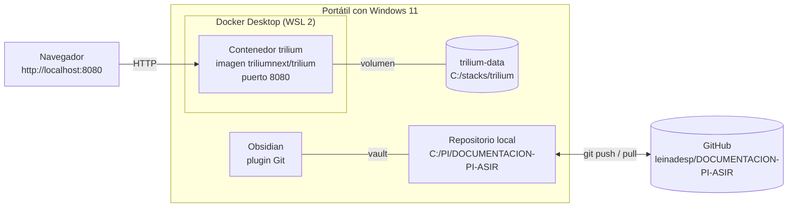
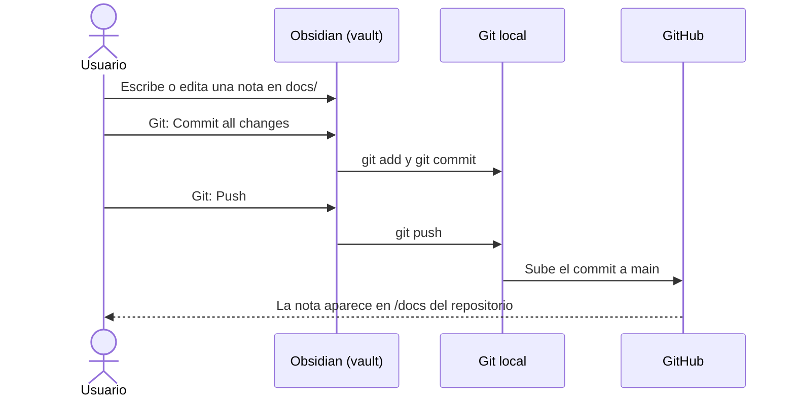

# Arquitectura del despliegue

**Dirigido a:** quien necesite entender cómo está montado el entorno antes de tocarlo o replicarlo. Para montarlo paso a paso, ver [deployment.md](deployment.md).

## Visión general
El entorno corre en un único portátil con Windows 11. Tiene dos piezas independientes:

- **Trilium Notes**, que corre en un contenedor Docker y se usa desde el navegador. Es la bitácora del proyecto.
- **Obsidian**, que trabaja sobre un clon local de este repositorio. El plugin Git sube los cambios a GitHub.

## Componentes

| Componente | Función | Ubicación |
|---|---|---|
| Docker Desktop (WSL 2) | Motor que ejecuta el contenedor | Windows 11 |
| Contenedor `trilium` | Servidor de Trilium Notes, puerto 8080 | `C:\stacks\trilium` |
| Volumen `trilium-data` | Base de datos y configuración de Trilium | `C:\stacks\trilium\trilium-data` |
| Obsidian + plugin Git | Edición de la documentación y control de versiones | Windows 11 |
| Repositorio local | Vault de Obsidian | `C:\PI\DOCUMENTACION-PI-ASIR` |
| Repositorio remoto | Copia publicada y respaldo | GitHub, `leinadesp/DOCUMENTACION-PI-ASIR` |

## Diagrama de componentes

## Flujo de sincronización de Obsidian

## Persistencia de datos
- Los datos de Trilium están en `C:\stacks\trilium\trilium-data`, montada como volumen dentro del contenedor. Se conservan aunque el contenedor se pare o se recree.
- Las notas de Obsidian son archivos Markdown del repositorio local. La carpeta `.obsidian/` (configuración local) está excluida con `.gitignore` y no se sube.

## Decisiones de arquitectura
Se registran como ADR en la bitácora de Trilium. Resumen:

| ADR | Decisión | Motivo |
|---|---|---|
| ADR-001 | Desplegar Trilium (Docker) y Obsidian (vault sincronizado con Git) | Cumplen la práctica y se ponen en marcha con rapidez. BookStack y Wiki.js necesitan base de datos aparte, y Confluence es SaaS de pago |
| ADR-002 | Cada servicio Docker en `stacks/<servicio>` | Facilita copias de seguridad, migración y revisión |

## Consideraciones de seguridad
- Trilium sirve su interfaz por **HTTP sin cifrar** en el puerto 8080. Al ser un entorno local no supone problema.
- Si se expusiera a internet haría falta un proxy inverso con TLS y una contraseña robusta.
- La contraseña de Trilium la establece el usuario en el asistente inicial y no se guarda en este repositorio.

## Limitaciones
- Entorno de un solo equipo y un solo usuario: no hay alta disponibilidad ni colaboración en tiempo real.
- No hay copias de seguridad automáticas (ver [user_manual.md](user_manual.md) para la copia manual).